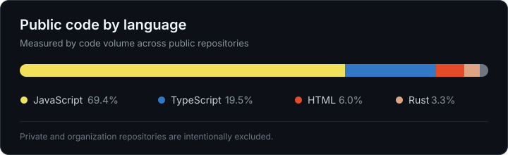

## What I’m good at

<table>
  <tr>
    <td width="50%">
      <strong>Product clarity</strong> 
      Turning dense mechanics into interfaces and flows people can understand.
    </td>
    <td width="50%">
      <strong>Full-stack execution</strong> 
      Connecting frontend, APIs, data and infrastructure into one reliable product.
    </td>
  </tr>
  <tr>
    <td width="50%">
      <strong>Protocol systems</strong> 
      Working across Solana programs, market structure and onchain operations.
    </td>
    <td width="50%">
      <strong>Product iteration</strong> 
      Moving from rough idea to shipped product through fast, practical feedback loops.
    </td>
  </tr>
</table>

## Core skills

  
  
  
  
  
  
  
  
  
  

## Code profile

<picture>
  
</picture>
